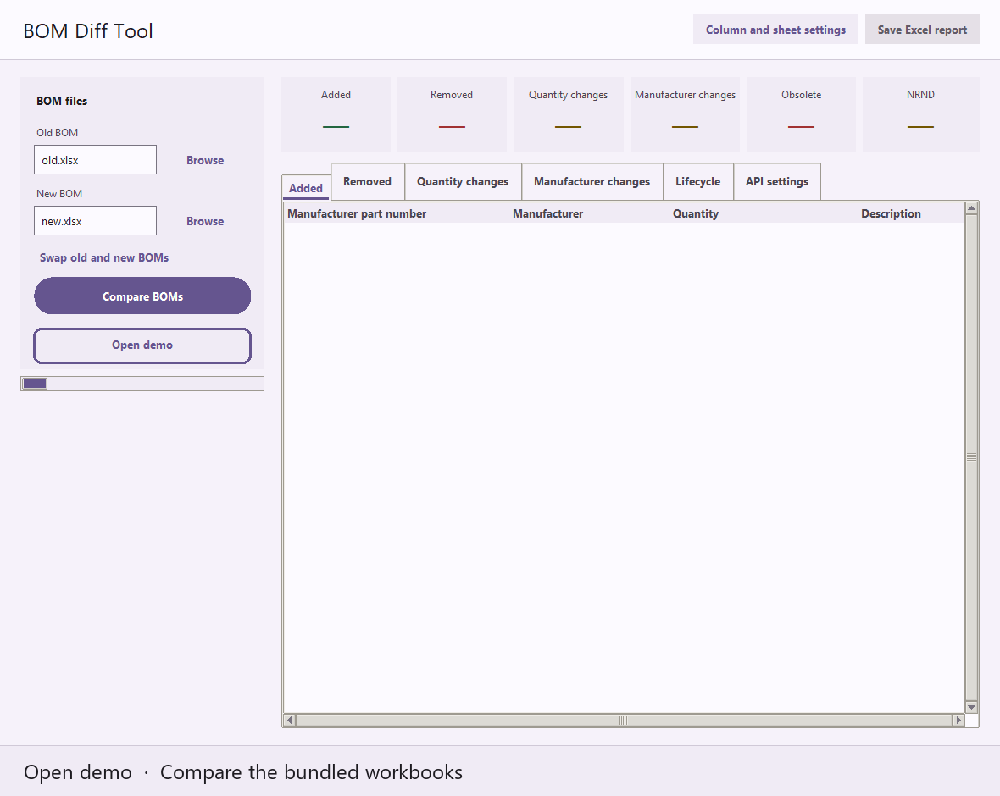
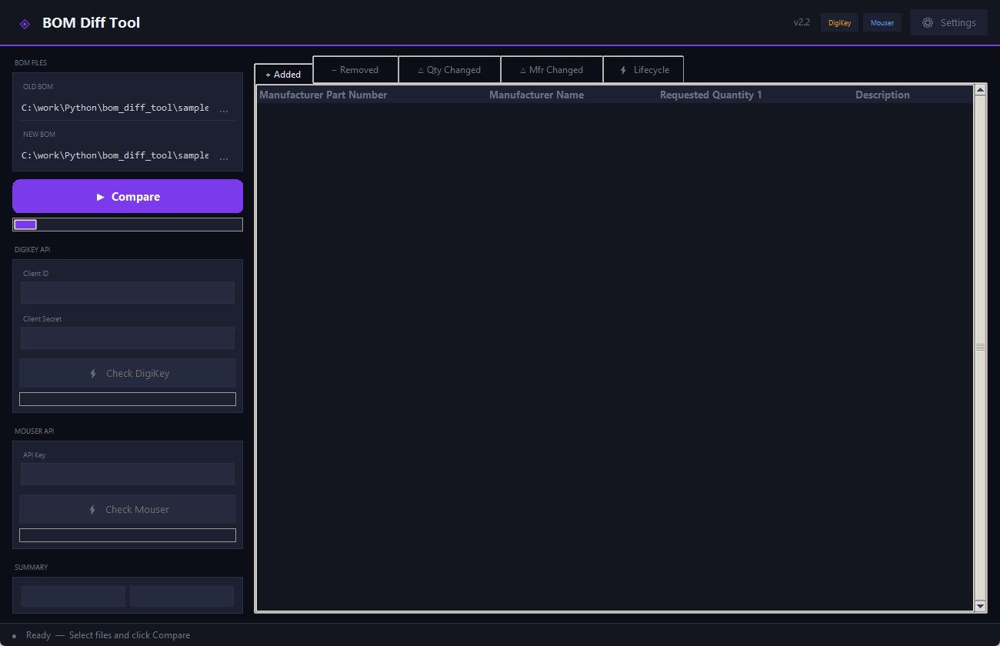
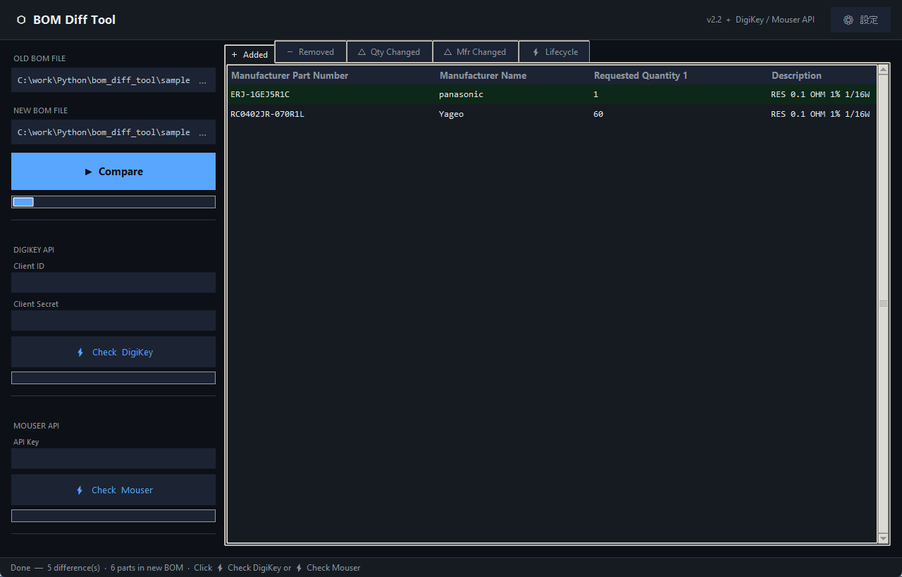

# BOM Diff Tool

A Python desktop tool for comparing BOM (Bill of Materials) files and detecting differences.  
Supports lifecycle checking (Obsolete / NRND detection) via the **DigiKey API** and **Mouser API**.

**[日本語版はこちら → README_JP.md](README_JP.md)**

```
┌──────────────────────────────────────────────────────────────┐
│  ⬡  BOM Diff Tool          v2.2  +  DigiKey / Mouser API   │
├───────────────┬──────────────────────────────────────────────┤
│ OLD BOM FILE  │  ┌─ Tabs ──────────────────────────────────┐ │
│ [old.xlsx  ]… │  │ ＋Added │－Removed │△Qty │△Mfr │⚡Life │ │
│               │  ├─────────────────────────────────────────┤ │
│ NEW BOM FILE  │  │ Part Number  │ Mfr Name │ Qty  │  ...   │ │
│ [new.xlsx  ]… │  │ GRM188R61... │ Murata   │ 100  │  ...   │ │
│               │  └─────────────────────────────────────────┘ │
│ ▶ Compare    │                                               │
│ ─────────────│  ⚡ Lifecycle Tab                              │
│ DIGIKEY API  │  ┌─────────────────────────────────────────┐ │
│ Client ID    │  │ Part Number  │ Status    │ ...           │ │
│ [••••••••••] │  │ GRM188R61... │ Obsolete  │ ...           │ │
│ Client Secret│  │ LQW18AN10... │ Active    │ ...           │ │
│ [••••••••••] │  │ RC0402JR-... │ Not Found │ ...           │ │
│⚡ Check DK   │  └─────────────────────────────────────────┘ │
│ ─────────────│  SUBSTITUTES  (DigiKey / Mouser)              │
│ MOUSER API   │  ┌─────────────────────────────────────────┐ │
│ API Key      │  │ Mfr Part No │ DK/Mouser P/N │ Source    │ │
│ [••••••••••] │  └─────────────────────────────────────────┘ │
│⚡ Check MS   │                                               │
│ ─────────────│                                    ⚙ Settings│
│ SUMMARY      │                                               │
│ Added    [ 1]│                                               │
│ Removed  [ 1]│                                               │
│ Qty Δ    [ 1]│                                               │
│ Mfr Δ    [ 1]│                                               │
│ Obsolete [ 2]│                                               │
│ NRND     [ 1]│                                               │
│↓ Save Report │                                               │
└───────────────┴──────────────────────────────────────────────┘
```

---

## Demo

Point to your two BOM files, hit **▶ Compare** — every added, removed, and changed part surfaces instantly across color-coded tabs.



| Phase | What you see |
|---|---|
| **Typing** | File paths entered — column names are auto-detected from the Excel headers |
| **▶ Compare** | BOM diff runs in the background; progress bar animates while processing |
| **Added tab** | New parts highlighted in green with part number, manufacturer, and quantity |
| **Tab sweep** | Removed → Qty Changed tabs each show their own categorized diff |
| **Summary badges** | Added · Removed · Qty Δ · Mfr Δ counts shown at a glance in the sidebar |

---

## Screenshots

**① File selection — paths typed in, column headers auto-recognized**



The left panel groups inputs into cards: **BOM FILES** at the top, **DigiKey / Mouser API** credentials below, and **Summary badges** at the bottom.

**② After ▶ Compare — added parts appear as green rows in the Added tab**



The status bar shows a live summary (`Done — 5 difference(s) · 6 parts in new BOM`).
The **DigiKeyで確認** and **Mouserで確認** buttons become active — click either to run a lifecycle check on the new parts.

**③ Results exported to bom_diff_report.xlsx — one sheet per diff category**


---

## Features

| Feature | Description |
|---|---|
| BOM diff comparison | Automatically detects added, removed, quantity changes, and manufacturer changes |
| Custom column names | Change column names via ⚙ Settings (saved to config.ini) |
| DigiKey lifecycle check | Color-coded display of Active / NRND / Obsolete status via DigiKey API |
| Mouser lifecycle check | Color-coded display of Active / NRND / Obsolete status via Mouser API |
| Substitute parts display | Shows DigiKey Substitutions / Mouser SuggestedReplacement with source label |
| Excel report output | Exports results to separate sheets in an Excel file |
| Prepare tool | Removes unnecessary columns from any Excel file and saves as old/new.xlsx |
| CLI mode | Run without GUI using the `--cli` option |

---

## Download for Windows

### Setup executable

Download and run `BOM-Diff-Tool-Setup-Windows-x64.exe` from [GitHub Releases](https://github.com/bluerey0331/bom_diff_tool/releases). Python and Microsoft Excel are unnecessary to run the application. The **BOM Diff Tool** Start menu folder contains both language versions.

To build the installer on Windows x64, build the ZIP below, then run `python tools/build_installer.py --iscc "C:\Program Files (x86)\Inno Setup 6\ISCC.exe"`.

The release’s `release-metadata.json` records the source commit, working tree state, dependencies, and verification results. Use `SHA256SUMS.txt` to verify the downloads. To sign a setup build, provide a code-signing certificate and pass `--signtool`, `--thumbprint`, and `--timestamp-url`.

The comparison uses part number as its key. Missing or duplicate part numbers and missing or nonnumeric quantities stop the comparison with the input filename and Excel row numbers. If the two distributors disagree about a lifecycle status, the table shows both and the summary counts the more severe status for that part.

### Portable ZIP


1. Download `BOM-Diff-Tool-Windows-x64.zip` from the selected [GitHub release](https://github.com/bluerey0331/bom_diff_tool/releases).
2. Extract the full ZIP and open `BOM Diff Tool (English).exe` for English or `BOM Diff Tool.exe` for Japanese. The ZIP includes the Python runtime.
3. Select **Open demo** to compare the bundled workbooks. Each API has a **Test connection** button that works before you load a BOM.

Use **Save credentials** in **API settings** to save the values for the next launch. A lookup also saves the credentials entered for that provider. To remove saved credentials, clear that provider’s fields and select **Save credentials**.

Credentials are saved in Windows Credential Manager. Existing credentials in `config.ini` are migrated at startup. Column and sheet settings stay in `%LOCALAPPDATA%\BOM Diff Tool\config.ini`.

To build the ZIP with x64 Python on Windows, run `python -X utf8 -m pip install -r requirements.txt pyinstaller`, then `python tools/build_windows.py`. The **Windows download** GitHub Actions workflow can also build the ZIP and attaches it when a release is published.

## Requirements for running from source

- Python 3.11 or later
- Windows / macOS / Linux (requires tkinter)

---

## Installation

```bash
# 1. Clone the repository
git clone https://github.com/bluerey0331/bom_diff_tool.git
cd bom_diff_tool

# 2. Install dependencies
pip install -r requirements.txt

# 3. Create the config file
cp config.ini.example config.ini
# Optional: use config.ini to customize columns and sheet names
```

---

## Usage

### BOM Comparison Tool (Main)

```bash
python main.py          # GUI mode (default)
python main.py --cli    # CLI mode
```

**GUI workflow:**

1. Use **参照** to select the old and new Excel files, or type the paths directly. Use **旧BOMと新BOMを入れ替え** to swap them.
2. Click **BOMを比較** to see the difference counts and details.
3. To check lifecycle status, open **API設定**, enter credentials, and choose a provider.
   - **DigiKeyで確認** — uses DigiKey API (Client ID + Client Secret required)
   - **Mouserで確認** — uses Mouser Search API (API Key required)
4. Click **Excelレポートを保存** in the header and choose a destination.

### Prepare Tool (Preprocessing)

```bash
python prepare.py
```

Removes unnecessary columns from any Excel file and saves it as `old.xlsx` or `new.xlsx`.  
When you change column names via **⚙ Settings**, the 4 configured columns are automatically checked ON.

### CLI Mode

```bash
python main.py --cli --old old.xlsx --new new.xlsx --output report.xlsx
```

---

## Custom Column Names

The default column names are:

| Role | Default |
|---|---|
| Part Number (index key) | `Manufacturer Part Number` |
| Manufacturer | `Manufacturer Name` |
| Quantity | `Requested Quantity 1` |
| Description | `Description` |

**How to change:** Click the ⚙ Settings button in the GUI → enter column names → save.  
Settings are automatically saved to `config.ini` and persist across restarts.

> **Note:** Column names must match the actual header names in your Excel files exactly.  
> Use the **Prepare tool** to keep only the 4 required columns before running the comparison.

---

## DigiKey API Setup

1. Create an account at [DigiKey Developer Portal](https://developer.digikey.com/)
2. Register an application to get a **Client ID** and **Client Secret**
3. Enter and save the credentials in **API settings** on Windows, or use environment variables

```ini
[digikey]
client_id     = YOUR_CLIENT_ID_HERE
client_secret = YOUR_CLIENT_SECRET_HERE
```

**Using environment variables (recommended):**

```bash
# Windows
set DIGIKEY_CLIENT_ID=your_client_id
set DIGIKEY_CLIENT_SECRET=your_client_secret

# Mac / Linux
export DIGIKEY_CLIENT_ID=your_client_id
export DIGIKEY_CLIENT_SECRET=your_client_secret
```

---

## Mouser API Setup

1. Create an account at [Mouser API Hub](https://www.mouser.com/api-hub/)
2. Generate an **API Key** from the developer portal
3. Enter and save the key in **API settings** on Windows, or use an environment variable

```ini
[mouser]
api_key = YOUR_MOUSER_API_KEY_HERE
```

**Using an environment variable (recommended):**

```bash
# Windows
set MOUSER_API_KEY=your_api_key

# Mac / Linux
export MOUSER_API_KEY=your_api_key
```

> **Rate limit:** 30 requests/minute, 1,000 requests/day.

---

## Lifecycle Status Colors

| Color | Status | Meaning |
|---|---|---|
| 🔴 Red | Obsolete | Part has been discontinued |
| 🟠 Orange | NRND | Not Recommended for New Designs |
| 🟢 Green | Active | Currently available |
| ⬛ Gray | Not Found | Part not found in the API database |

---

## Sample Data

`samples/sample_old.xlsx` and `samples/sample_new.xlsx` contain dummy data for testing.

Select them via the **…** buttons in the GUI, or copy them first:

```bash
# macOS / Linux
cp samples/sample_old.xlsx old.xlsx
cp samples/sample_new.xlsx new.xlsx

# Windows
copy samples\sample_old.xlsx old.xlsx
copy samples\sample_new.xlsx new.xlsx
```

Then run `python main.py` and click **▶ Compare**.

The sample data includes the following changes between old and new:

| Change type | Part |
|---|---|
| Added | ERJ-1GEJ5R1C |
| Added | RC0402JR-070R1L |
| Removed | MMBT3904LT1G |
| Quantity changed | LQW18AN10NG00D (50 → 80) |
| Manufacturer changed | ERJ-2RKF1001X (Panasonic → Yageo) |

---

## Project Structure

```
bom-diff-tool/
├── main.py                  # Entry point (BOM comparison tool)
├── prepare.py               # Preprocessing tool
├── run.bat                  # Launch BOM comparison tool (Windows)
├── run_prepare.bat          # Launch preprocessing tool (Windows)
├── requirements.txt         # Python dependencies
├── config.ini.example       # Config file template (no credentials)
├── README.md                # This file (English)
├── README_JP.md             # Japanese README
├── LICENSE                  # MIT License
├── CHANGELOG.md             # Version history
├── samples/
│   ├── sample_old.xlsx      # Sample data (old BOM)
│   └── sample_new.xlsx      # Sample data (new BOM)
├── src/
│   ├── column_config.py     # Column name settings (read/write)
│   ├── comparator.py        # BOM comparison logic
│   ├── digikey_client.py    # DigiKey API client
│   ├── mouser_client.py     # Mouser API client
│   ├── gui.py               # Main GUI
│   ├── loader.py            # Excel loader
│   ├── preprocessor.py      # Preprocessing logic
│   ├── report.py            # Excel report output
│   └── settings_dialog.py   # Column name settings dialog
├── tests/
│   └── test_all.py          # Automated tests (pytest)
├── make_demo_gif.py     # Demo GIF generator
├── capture_demo.py      # Screenshot capture script
├── tools/
│   ├── build_windows.py
│   ├── build_installer.py
│   └── release_metadata.py
└── .github/
    └── workflows/
        └── test.yml         # GitHub Actions CI
```

---

## Running Tests

```bash
pip install pytest
pytest tests/ -v
```

---

## License

[MIT License](LICENSE)
