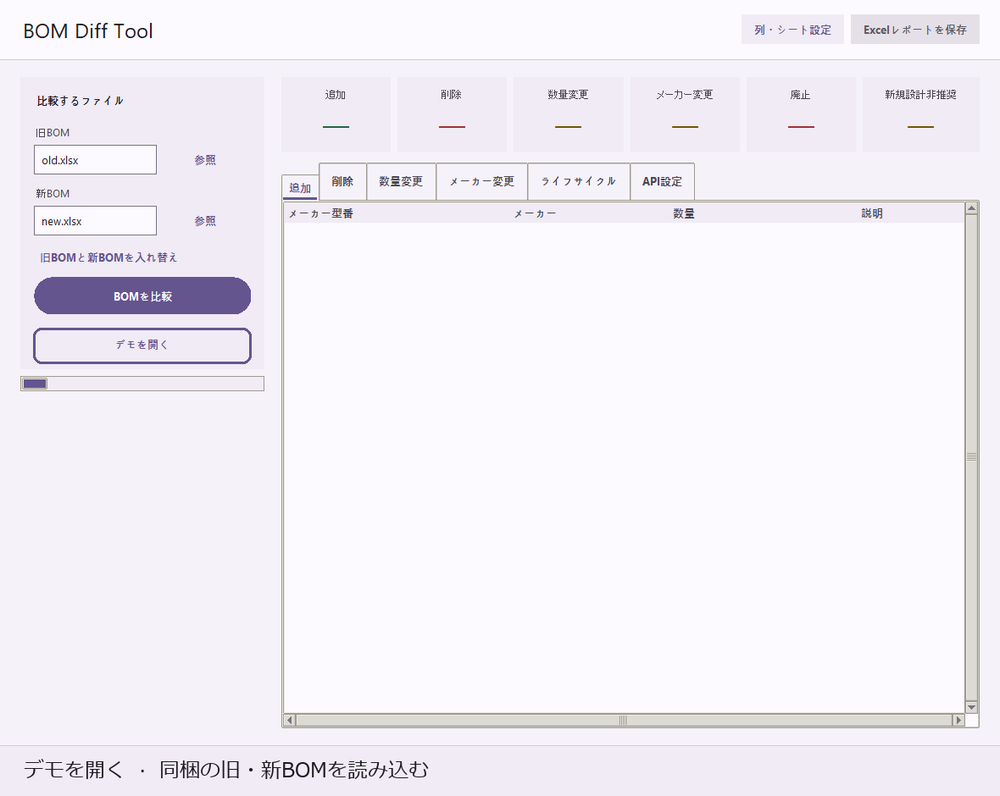
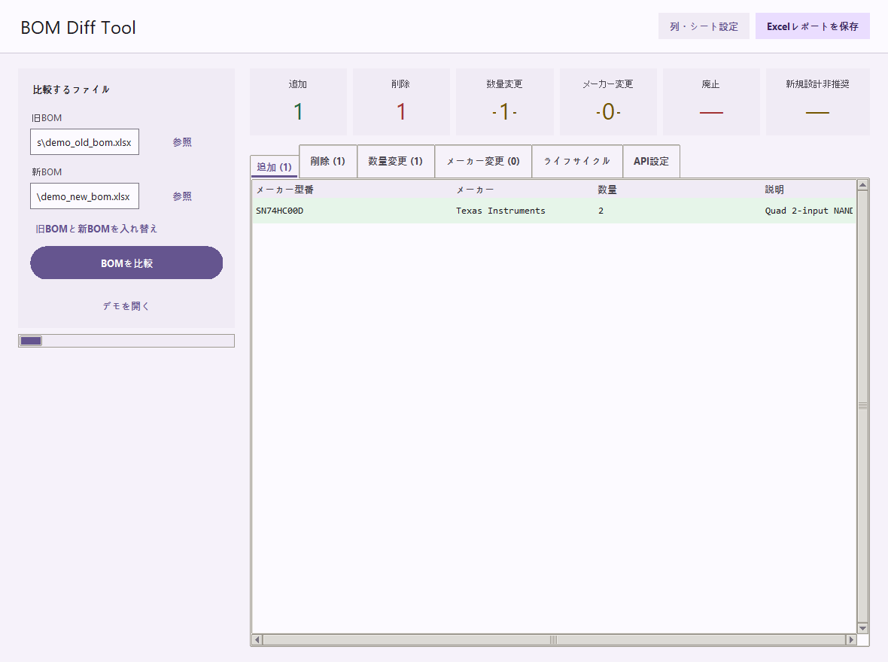
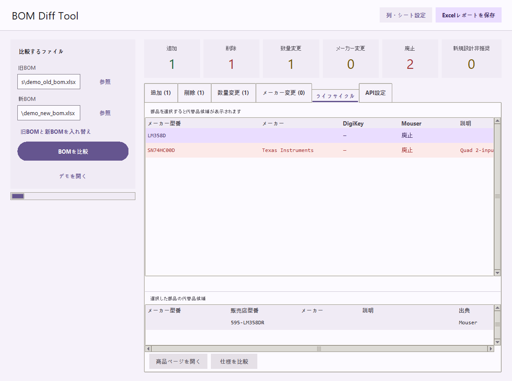

# BOM Diff Tool

BOM（部品表）を比較して差分を検出する Python 製デスクトップツールです。  
**DigiKey API** / **Mouser API** を使ったライフサイクルチェック（廃品・NRND 検出）にも対応しています。

**[English README is here → README.md](README.md)**

## デモ

**デモを開く** を押すと、同梱の旧・新BOMを比較します。GIFでは追加部品、数量変更、Mouserの代替品候補の表示例、Excelレポートの保存を確認できます。



### 比較結果と代替品候補





代替品の画面には、過去にMouserの実APIで確認した応答例を使っています。実際の照会にはAPIキーが必要で、カタログの更新により結果が変わることがあります。

---

## 機能一覧

| 機能 | 説明 |
|---|---|
| BOM 差分比較 | 追加・削除・Quantity変更・Manufacturer変更を自動検出 |
| カラム名カスタマイズ | ⚙ 設定から任意のカラム名に変更可能（config.ini に保存） |
| DigiKey ライフサイクル | DigiKey API で Active / NRND / Obsolete を色分け表示 |
| Mouser ライフサイクル | Mouser API で Active / NRND / Obsolete を色分け表示 |
| 代替品表示 | DigiKey Substitutions / Mouser SuggestedReplacement をSource付きで表示 |
| Excel レポート出力 | 差分・ライフサイクル結果をシート別に出力 |
| Prepare ツール | 任意Excelから不要列を削除して old/new.xlsx として保存 |
| CLI モード | `--cli` オプションで GUI なし実行可能 |

---

## Windows 版のダウンロード

### セットアップEXE

[GitHub Releases](https://github.com/bluerey0331/bom_diff_tool/releases) から `BOM-Diff-Tool-Setup-Windows-x64.exe` をダウンロードして実行してください。PythonやExcelのインストールは不要です。インストール後、スタートメニューの **BOM Diff Tool** から日本語版・英語版を選べます。

Windows x64でセットアップEXEを作る場合は、下記のZIPをビルドしてから `python tools/build_installer.py --iscc "C:\Program Files (x86)\Inno Setup 6\ISCC.exe"` を実行します。

配布ページの `release-metadata.json` にビルド元のコミット、作業ツリーの状態、依存関係と検証結果を記録します。`SHA256SUMS.txt` でダウンロードしたファイルを照合できます。署名付きセットアップを作る場合は、コード署名証明書を用意し、ビルド時に `--signtool`、`--thumbprint`、`--timestamp-url` を指定します。

BOM は型番を照合キーにします。型番の空欄・重複、数量の空欄・非数値がある場合は、入力ファイルとExcelの行番号を表示して比較を止めます。両社のライフサイクル判定が異なる場合、明細に両方の判定を出し、上部の件数には部品ごとにより厳しい判定を反映します。

### ポータブルZIP


1. [GitHub Releases](https://github.com/bluerey0331/bom_diff_tool/releases) の対象リリースから `BOM-Diff-Tool-Windows-x64.zip` をダウンロードします。
2. ZIP 全体を展開し、日本語版は `BOM Diff Tool.exe`、英語版は `BOM Diff Tool (English).exe` を開きます。Python のインストールは不要です。
3. **デモを開く** で同梱の旧・新BOMを比較できます。各APIの **接続テスト** はBOMを読み込む前に実行できます。

「API設定」の **認証情報を保存** で次回起動時に入力内容を復元できます。照会を開始したときも、そのサービスに入力した認証情報を保存します。保存済みの認証情報を削除するには、対象サービスの入力欄を空にして **認証情報を保存** を押します。

認証情報はWindows資格情報マネージャーに保存されます。従来の `config.ini` に保存されている認証情報は、初回起動時に移行します。列・シート設定は `%LOCALAPPDATA%\BOM Diff Tool\config.ini` に保存されます。

Windows x64 の Python 環境で配布 ZIP を作るには、`python -X utf8 -m pip install -r requirements.txt pyinstaller` を実行してから `python tools/build_windows.py` を実行します。GitHub Actions の **Windows download** からもビルドでき、リリースを公開すると ZIP が添付されます。

## ソース版の必要環境

- Python 3.11 以上
- Windows / macOS / Linux（tkinter が使える環境）

---

## インストール

```bash
# 1. リポジトリをクローン
git clone https://github.com/bluerey0331/bom_diff_tool.git
cd bom_diff_tool

# 2. 依存パッケージをインストール
pip install -r requirements.txt

# 3. 設定ファイルを作成
cp config.ini.example config.ini
# 列名・シート名をカスタマイズする場合に使います
```

---

## 使い方

### BOM 比較ツール（メイン）

```bash
python main.py          # GUI モード（デフォルト）
python main.py --cli    # CLI モード
```

**GUI の操作フロー：**

1. **参照** で旧BOM・新BOMを選びます。ファイルパスの入力や旧・新の入れ替えもできます。
2. **BOMを比較** を押すと、差分の件数と明細が表示されます。
3. ライフサイクルチェックを行う場合は、**API設定** タブを開いて認証情報を入力し、次のいずれかを押します。
   - **DigiKeyで確認** — DigiKey API を使用（Client ID + Client Secret が必要）
   - **Mouserで確認** — Mouser Search API を使用（API Key が必要）
4. 画面上部の **Excelレポートを保存** から保存先を選びます。

### Prepare ツール（前処理）

```bash
python prepare.py
```

Excel ファイルから不要な列を削除して `old.xlsx` / `new.xlsx` として保存します。  
**⚙ 設定** から使用するカラム名を変更すると、設定した4列が自動的にチェックONになります。

### CLI モード

```bash
python main.py --cli --old old.xlsx --new new.xlsx --output report.xlsx
```

---

## カラム名のカスタマイズ

デフォルトのカラム名は以下の通りです。

| 論理名 | デフォルト |
|---|---|
| Part Number（キー列） | `Manufacturer Part Number` |
| Manufacturer | `Manufacturer Name` |
| Quantity | `Requested Quantity 1` |
| Description | `Description` |

**変更方法：** GUI の ⚙ 設定 ボタン → カラム名を入力 → 保存  
設定は `config.ini` に自動保存され、次回起動時も維持されます。

> **注意：** カラム名は Excel ファイルのヘッダーと完全一致させてください。  
> **Prepare ツール**を使って4列だけ残してから比較することを推奨します。

---

## DigiKey API の設定

1. [DigiKey Developer Portal](https://developer.digikey.com/) でアカウントを作成
2. アプリを登録して **Client ID** と **Client Secret** を取得
3. Windowsの「API設定」から認証情報を保存するか、環境変数で設定

```ini
[digikey]
client_id     = YOUR_CLIENT_ID_HERE
client_secret = YOUR_CLIENT_SECRET_HERE
```

**環境変数での設定（推奨）：**

```bash
# Windows
set DIGIKEY_CLIENT_ID=your_client_id
set DIGIKEY_CLIENT_SECRET=your_client_secret

# Mac / Linux
export DIGIKEY_CLIENT_ID=your_client_id
export DIGIKEY_CLIENT_SECRET=your_client_secret
```

---

## Mouser API の設定

1. [Mouser API Hub](https://www.mouser.com/api-hub/) でアカウントを作成
2. Developer Portal から **API Key** を発行
3. Windowsの「API設定」から認証情報を保存するか、環境変数で設定

```ini
[mouser]
api_key = YOUR_MOUSER_API_KEY_HERE
```

**環境変数での設定（推奨）：**

```bash
# Windows
set MOUSER_API_KEY=your_api_key

# Mac / Linux
export MOUSER_API_KEY=your_api_key
```

> **レート制限：** 30 リクエスト/分、1,000 リクエスト/日

---

## ライフサイクルステータスの色

| 色 | ステータス | 意味 |
|---|---|---|
| 🔴 赤 | Obsolete | 廃品（製造中止） |
| 🟠 橙 | NRND | 新規設計非推奨 |
| 🟢 緑 | Active | 現行品 |
| ⬛ グレー | Not Found | API データベースに未登録 |

---

## サンプルデータ

`samples/sample_old.xlsx` と `samples/sample_new.xlsx` に動作確認用のダミーデータが含まれています。

GUI の **…** ボタンで直接選択するか、以下のようにコピーして使用してください。

```bash
# macOS / Linux
cp samples/sample_old.xlsx old.xlsx
cp samples/sample_new.xlsx new.xlsx

# Windows
copy samples\sample_old.xlsx old.xlsx
copy samples\sample_new.xlsx new.xlsx
```

その後 `python main.py` を実行して **▶ Compare** をクリックしてください。

サンプルデータに含まれる変更点：

| 変更種別 | 部品 |
|---|---|
| 追加 | ERJ-1GEJ5R1C |
| 追加 | RC0402JR-070R1L |
| 削除 | MMBT3904LT1G |
| Quantity 変更 | LQW18AN10NG00D（50 → 80） |
| Manufacturer 変更 | ERJ-2RKF1001X（Panasonic → Yageo） |

---

## プロジェクト構成

```
bom-diff-tool/
├── main.py                  # エントリーポイント（BOM比較ツール）
├── prepare.py               # 前処理ツール
├── run.bat                  # BOM比較ツール起動用（Windows）
├── run_prepare.bat          # 前処理ツール起動用（Windows）
├── requirements.txt         # 依存パッケージ
├── config.ini.example       # 設定ファイルのテンプレート
├── README.md                # 英語版 README（標準）
├── README_JP.md             # このファイル（日本語）
├── LICENSE                  # MIT License
├── CHANGELOG.md             # 変更履歴
├── samples/
│   ├── sample_old.xlsx      # サンプルデータ（旧BOM）
│   └── sample_new.xlsx      # サンプルデータ（新BOM）
├── src/
│   ├── column_config.py     # カラム名設定の読み書き
│   ├── comparator.py        # BOM比較ロジック
│   ├── digikey_client.py    # DigiKey API クライアント
│   ├── mouser_client.py     # Mouser API クライアント
│   ├── gui.py               # メインGUI
│   ├── loader.py            # Excel読み込み
│   ├── preprocessor.py      # 前処理ロジック
│   ├── report.py            # Excelレポート出力
│   └── settings_dialog.py   # カラム名設定ダイアログ
├── tests/
│   └── test_all.py          # 自動テスト（pytest）
├── make_demo_gif.py     # デモGIF生成スクリプト
├── capture_demo.py      # スクリーンショット撮影スクリプト
├── tools/
│   ├── build_windows.py
│   ├── build_installer.py
│   └── release_metadata.py
└── .github/
    └── workflows/
        └── test.yml         # GitHub Actions 自動テスト
```

---

## テストの実行

```bash
pip install pytest
pytest tests/ -v
```

---

## ライセンス

[MIT License](LICENSE)
